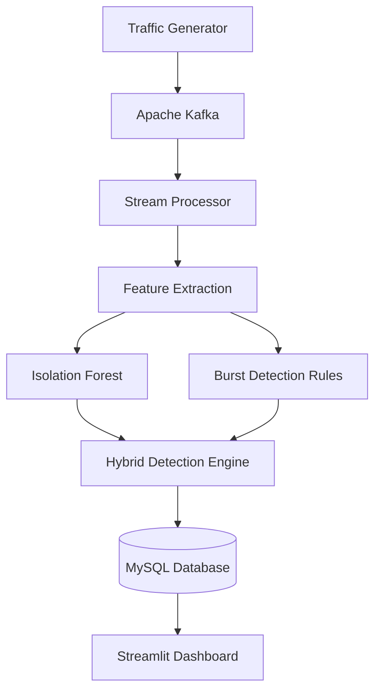

# 🛡️ API Sentinel
### Real-Time API Abuse Detection System

API Sentinel is a real-time API traffic monitoring and abuse detection system that identifies suspicious client behaviour using **Machine Learning and rule-based detection**.

The system processes API requests through Apache Kafka, extracts behavioural features, detects anomalies using Isolation Forest, and stores suspicious events in MySQL. A Streamlit dashboard provides visual monitoring and threat investigation.

## 🚀 Features

- Real-time API traffic generation and streaming
- Kafka-based event processing
- Rolling 10-second client activity analysis
- Machine Learning-based anomaly detection using Isolation Forest
- Rule-based burst detection
- Hybrid anomaly detection combining ML and burst rules
- Detection of suspicious traffic patterns:
  - Bot traffic bursts
  - Brute-force attempts
  - Endpoint scanning
- MySQL event and alert storage
- Interactive Security Operations Centre dashboard
- Client intelligence and API endpoint analytics
- Event log investigation and CSV export

## 🏗️ System Architecture



## 🧰 Technology Stack

| Component | Technology |
|---|---|
| Programming Language | Python |
| Message Streaming | Apache Kafka 4.1 |
| Database | MySQL 8.4 |
| Machine Learning | Scikit-learn |
| Anomaly Detection | Isolation Forest |
| Dashboard | Streamlit |
| Data Processing | Pandas, NumPy |
| Visualisation | Plotly |
| Containerisation | Docker Compose |

## 📁 Project Structure

```text
api-abuse-detection/
│
├── dashboard/
│   └── app.py
│
├── database/
│   └── setup_db.py
│
├── data/
│
├── ml/
│   ├── train_model.py
│   └── isolation_forest.joblib
│
├── processor/
│   └── stream_processor.py
│
├── producer/
│   └── traffic_generator.py
│
├── docker-compose.yml
├── requirements.txt
├── .gitignore
└── README.md
```

## ⚙️ Installation and Setup

### 1. Clone the repository

```bash
git clone YOUR_GITHUB_REPOSITORY_URL
cd api-abuse-detection
```

### 2. Create a virtual environment

```bash
python3 -m venv .venv
source .venv/bin/activate
```

### 3. Install dependencies

```bash
pip install -r requirements.txt
```

### 4. Configure environment variables

Create a local `mp.env` file in the project root:

```env
MYSQL_ROOT_PASSWORD=your_mysql_root_password
MYSQL_PASSWORD=your_mysql_user_password
```

Never upload this file to GitHub.

### 5. Start Kafka and MySQL

```bash
docker compose --env-file mp.env up -d
```

### 6. Initialise the database

Run the database setup script:

```bash
python database/setup_db.py
```

### 7. Train the machine learning model

```bash
python ml/train_model.py
```

### 8. Start the stream processor

Load the environment variables:

```bash
set -a
source mp.env
set +a
```

Run:

```bash
python processor/stream_processor.py
```

### 9. Start the traffic generator

In a separate terminal:

```bash
source .venv/bin/activate
python producer/traffic_generator.py
```

### 10. Launch the dashboard

In another terminal:

```bash
source .venv/bin/activate
set -a
source mp.env
set +a

streamlit run dashboard/app.py
```

Open:

http://localhost:8501

## 🧠 Detection Methodology

### Isolation Forest

The machine learning model analyses behavioural features extracted from API traffic:

- Requests per 10 seconds
- Failure ratio
- Average response latency
- Endpoint diversity

Isolation Forest identifies unusual traffic patterns and assigns anomaly predictions and scores.

### Burst Detection

A rule-based detection mechanism flags clients generating at least 15 requests within the rolling 10-second window.

### Hybrid Detection

The system combines both approaches:

- **Isolation Forest:** identifies statistically unusual behaviour.
- **Burst Detection:** identifies high-frequency request patterns.
- **Hybrid Detection:** flags traffic detected by both methods.

## 📊 Dashboard

The API Sentinel dashboard provides six sections:

1. **Overview** – System-wide traffic and threat statistics.
2. **Live Traffic** – Request activity, HTTP status codes and latency.
3. **Threat Detection** – Suspicious events and alert history.
4. **Client Intelligence** – Client-level behaviour analysis.
5. **API Analytics** – Endpoint usage and performance.
6. **Event Logs** – Search, investigate and export events.

## 🧪 Model Evaluation

The Isolation Forest model was evaluated using a synthetic dataset.

The reported experimental results were:

- Accuracy: 94%
- Suspicious traffic precision: 82%
- Suspicious traffic recall: 84%
- Suspicious traffic F1-score: 0.83

These metrics represent synthetic-data evaluation and should not be interpreted as real-world production performance.

## 🔮 Future Improvements

- Real-world API traffic datasets
- Advanced attack classification
- Authentication and rate-limiting integration
- Real-time notification system
- Model retraining and performance monitoring
- Deployment to a cloud environment

## 👨‍💻 Project

**API Sentinel – Real-Time API Abuse Detection System**

Developed as an academic mini-project.

---

*Built with Python, Apache Kafka, MySQL and Machine Learning.*